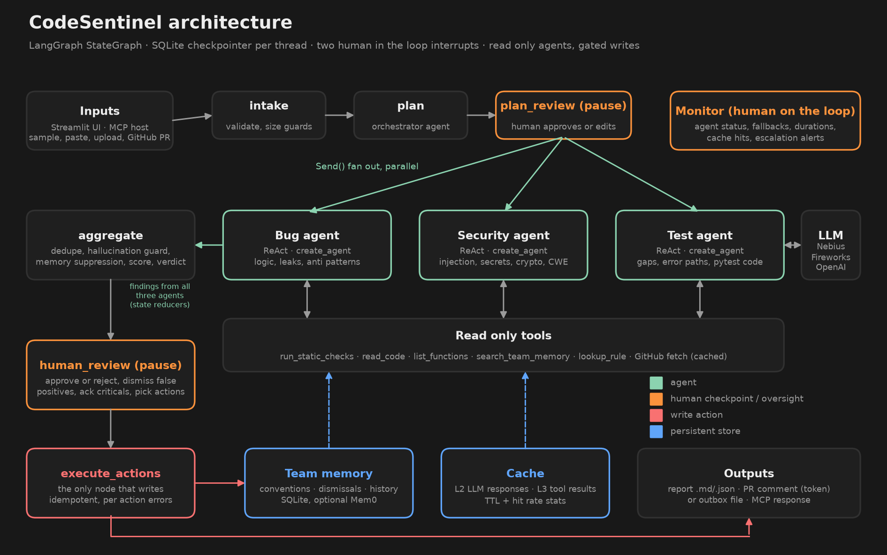

# CodeSentinel: a multi agent code review system

**Week 3 project, Mastering Agentic AI (The Gen Academy).** Use case **3E, Code Review Agent**, built on the **code track (LangChain + LangGraph)** with a Streamlit interface.

**Live app:** https://balaweek3project-codesentinel.streamlit.app/ (LLM agents on with Nebius Llama 3.3 70B through the app's Secrets; without the secret it runs in rule based mode)

> **One liner.** CodeSentinel helps a software engineer or tech lead review a pull request in a web app, replacing the 30 to 45 minutes of manual line by line review and security checklist work it takes today. It finds bugs, security vulnerabilities and test gaps on its own using 3 specialist agents and 6 read only tools, hands off to a human before the plan runs and before anything is posted, saved to memory or shared, and I'll know it works when a reviewer gets a prioritised, grounded review in under 2 minutes that catches at least 9 out of 10 seeded issues.



## What it does

1. **Intake** checks the files (size limits, binary and empty files, file count cap) and picks a memory namespace (`owner/repo` for GitHub links).
2. **Orchestrator** plans the review: which specialists to run, what to focus on, and the risk level.
3. **Plan approval (human in the loop 1).** The graph pauses with `interrupt()`. The reviewer can edit the agent list and focus areas, or cancel.
4. **Three specialists run in parallel** (LangGraph `Send` fan out). Each is a ReAct agent (`create_agent`) with read only tools:
   * **Bug agent:** logic errors, leaks, swallowed exceptions, anti patterns, complexity.
   * **Security agent:** injection, hardcoded secrets, weak crypto, unsafe deserialization, path traversal, JWT misuse, with CWE ids.
   * **Test agent:** untested functions, untested error paths, and ready to paste `pytest` tests.
5. **Aggregate.** Code, not the model, decides the outcome: dedupe, drop ungrounded LLM findings, apply team memory suppressions, rank by severity, score (0 to 100), verdict (approve, approve with comments, request changes, block) and escalations.
6. **Report approval (human in the loop 2).** The reviewer reads the ranked report, dismisses false positives with a reason, acknowledges critical findings and picks which write actions to allow.
7. **Execute actions,** the only node that writes: save the report, post a PR comment (idempotent; outbox file when no token), and store feedback in team memory.

## How the Week 3 concepts show up

| Week 3 topic | Where it lives |
|---|---|
| Agent vs workflow, MINT | A fixed graph skeleton (workflow) with model driven steps only where judgment is needed (planning, specialist review, summary). Static analysis does everything that does not need an LLM. |
| ReAct loop, tools | `codesentinel/agents/specialists.py`: `create_agent` with 5 tools; the docstring is the tool prompt |
| State, reducers | `ReviewState` in `codesentinel/graph.py` with `operator.add` reducers for parallel findings |
| Checkpointers | `SqliteSaver` per `thread_id`. The thread id lives in the URL, so a refresh or restart resumes the same review |
| Human in the loop | Two `interrupt()` points, `Command(resume=...)`, plus a code enforced rule that critical findings must be acknowledged before posting |
| Human on the loop | Monitor tab: agent status, fallbacks, durations, tool calls, dropped hallucinations, cache hit rates, escalation alerts |
| Multi agent patterns | Orchestrator plus parallel specialists (supervisor / fan out), typed hand offs via the `Finding` schema |
| Memory (Mem0 handout) | `codesentinel/memory.py`: per project conventions, dismissals enforced in code, score history; optional Mem0 platform mirror |
| Caching handout | `codesentinel/cache.py`: L1 prompt ordering, L2 LLM response cache, L3 tool result cache, TTLs and hit rate stats |
| MCP | `mcp_server.py` exposes `review_code`, `review_github`, `scan_security`, `get_team_conventions`, a rule catalog resource and a prompt |
| A2A | `a2a/agent-card.json` advertises the agent's skills and task lifecycle |
| Failure handling | Retries with backoff, model fallback, JSON repair, hallucination guard, per agent static fallback, step limits, idempotent writes |
| Evals | `evals/run_evals.py` with ground truth for seeded samples, plus real open source code from GitHub |

## Quick start

Requires Python 3.12 and [uv](https://docs.astral.sh/uv/).

```bash
uv sync
cp .env.example .env        # add NEBIUS_API_KEY (or FIREWORKS_API_KEY / OPENAI_API_KEY)
uv run streamlit run app.py
```

Without any key the app still works in **static mode**: the three agents fall back to the deterministic analyzers, and the monitor shows it. With a key, the specialists become LLM ReAct agents that use those analyzers as tools.

Optional settings in `.env`:

| Variable | Purpose |
|---|---|
| `NEBIUS_API_KEY`, `NEBIUS_MODEL` | Nebius Token Factory (course default). OpenAI compatible endpoint |
| `FIREWORKS_API_KEY`, `OPENAI_API_KEY` | Other providers. A second key becomes the automatic fallback model |
| `GITHUB_TOKEN` | Lets the approved "post comment" action post to the PR; without it the comment goes to `outbox/` |
| `MEM0_API_KEY` | Mirrors conventions and review history to the Mem0 platform |
| `LANGSMITH_TRACING`, `LANGSMITH_API_KEY` | Optional LangSmith traces |

### Run the tests and evals

```bash
uv run pytest -q
uv run python evals/run_evals.py
```

### Use it from an MCP host

```json
{
  "mcpServers": {
    "codesentinel": { "command": "uv", "args": ["--directory", "<path to this repo>", "run", "python", "mcp_server.py"] }
  }
}
```

MCP callers get read only reviews. Posting and memory writes stay behind the human approval step in the app.

## Results

Static mode results from `evals/results.md` (no LLM key):

| Sample | Seeded issues found | Precision (bugs + security) |
|---|---:|---:|
| Loyalty portal API (Flask) | 12 / 12 | 100% |
| Inventory sync pipeline | 12 / 12 | 100% |
| Checkout refunds with tests | 7 / 7 | 100% |

Real open source code reviewed from GitHub: `fportantier/vulpy` (3 critical SQL injections), `anxolerd/dvpwa` (SQL injection), `we45/Vulnerable-Flask-App` (hardcoded secrets, unverified JWT, SQL injection). Full reports are in [`sample_outputs/`](sample_outputs/).

The 8 "LLM only" issues in the ground truth (missing authorization, float equality on money, unbounded pagination) need semantic reasoning and are found only with an LLM key. Run the evals with your key to fill in that column.

## Project layout

```
app.py                       Streamlit UI (review, team memory, monitor, how it works)
mcp_server.py                MCP server over stdio
codesentinel/
  graph.py                   LangGraph: nodes, interrupts, Send fan out, checkpointer
  agents/orchestrator.py     planning, dedupe, scoring, verdict, escalations, summary
  agents/specialists.py      ReAct specialists, tools, grounding guard, merge, fallbacks
  agents/prompts.py          all prompts (static first for prefix caching)
  tools/static_analysis.py   29 deterministic rules (AST for Python, patterns for JS/TS/Java/Go)
  tools/github_tools.py      PR and file fetch (cached, retried) and idempotent PR comment
  memory.py  cache.py  llm.py  models.py  report.py  config.py  ui_style.py
samples/                     three seeded code samples
evals/                       ground truth, harness, results
sample_outputs/              generated review reports
tests/                       20 pytest tests, including scripted fake LLM tests
a2a/agent-card.json          A2A agent card
docs/                        project documentation, demo script, architecture diagram
```

## Design

The Streamlit UI follows the visual system from [elayadesign/ai-design-skills](https://github.com/elayadesign/ai-design-skills) (`landing-page-design`, Part B): Geist type on named text styles, the fixed spacing scale, nested radius rule, flat dark surfaces, hero gradient text, Phosphor icons, a weighted easing curve with reduced motion support, skeleton loaders instead of spinners, composed empty states and calm, specific system messages.

On top of that it uses the glass and 3D layer from our Team 24 LaneRoom app: a navy base with aurora light, a perspective grid floor and floating spheres, translucent glass panels, a hero card with a 3D tilted report preview that scans code, a pipeline strip that lights up each graph node from the checkpoint (done, waiting for you, skipped), a branded sidebar and pill tabs. The accent is teal because orange already means high severity. See `codesentinel/ui_style.py`.

## Hard limits

* Agents only read. They never modify code, post, or run the code under review.
* Every write runs only after explicit human approval, and MCP or eval runs cannot perform external writes.
* Critical findings cannot be posted without an explicit acknowledgement.
* No personal data is cached; caches hold code review results keyed by content hash and public GitHub responses.
