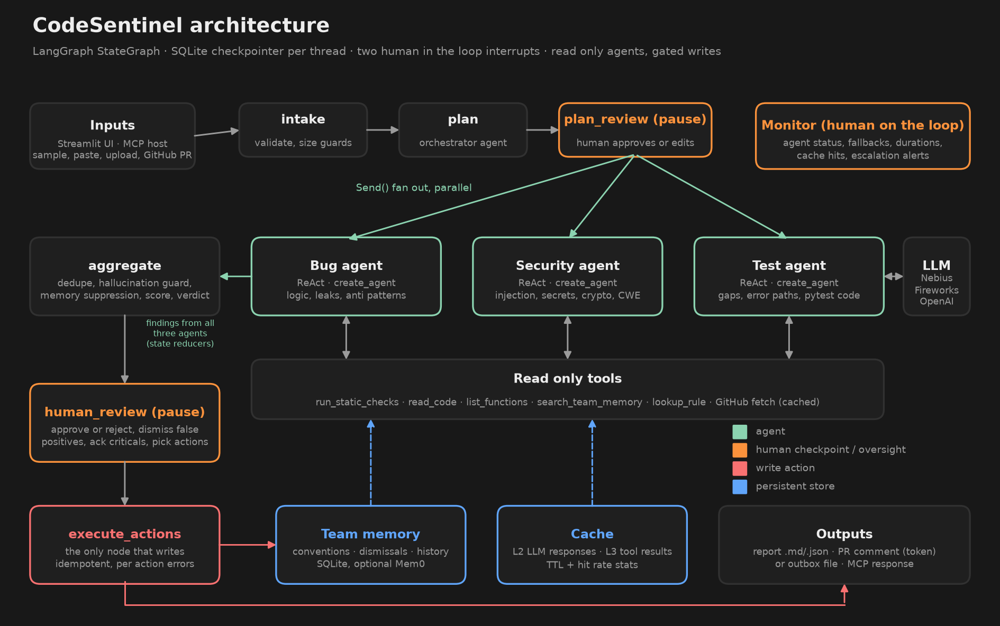

# CodeSentinel: Week 3 project documentation

**Author:** Bala (GitHub: balum211)
**Program:** Mastering Agentic AI Certification, Week 3: Agentic AI Systems
**Use case:** 3E, Code Review Agent
**Build track:** Track 2, code heavy with LangChain + LangGraph, Streamlit interface
**Repository:** https://github.com/balum211/BalaWeek3Project
**Live app:** https://balaweek3project-codesentinel.streamlit.app/

## 1. Project overview

CodeSentinel is a multi agent code review system. An orchestrator agent plans the review and three specialist agents (bugs and anti patterns, security, test coverage) inspect the code in parallel. The orchestrator then merges their findings into a single prioritised report with severity ratings, a quality score and a merge verdict. A human approves the plan before the agents run and approves the report before anything is saved, posted or remembered.

It is a real agentic system, not a single LLM call: the agents choose which tools to call and in what order, state is held across steps and checkpointed, failures are retried, rerouted or degraded, and every write action sits behind a human.

### The one liner

> My agent helps a **software engineer or tech lead** do **a full pull request review (bugs, security and test gaps)** in **a Streamlit web app (or any MCP host)**, replacing **30 to 45 minutes of manual line by line review and security checklist work per PR, which is often skipped under deadline pressure**. It does **the investigation and the prioritised write up** on its own using **3 specialist agents and 6 read only tools**, hands off to a human **before the plan runs and before anything is saved, posted or remembered**, and I'll know it works when **a reviewer** can **get a grounded, prioritised review** in under **2 minutes** with **at least 9 out of 10 seeded issues caught and no invented line numbers**.

### The agent framework

| Field | Answer |
|---|---|
| Agent goal | Review a code change and produce a prioritised findings report with a merge verdict. |
| Where people use it | Streamlit web app; also as an MCP server inside Claude Desktop, Claude Code or Cursor; A2A card for agent to agent use. |
| Steps in order | 1. Intake and validate files. 2. Orchestrator plans agents, focus and risk. 3. Human approves or edits the plan. 4. Bug, security and test agents run in parallel. 5. Orchestrator dedupes, grounds, suppresses, scores and decides the verdict. 6. Human reviews the report, dismisses false positives, picks actions. 7. Approved actions run. |
| What it can do | Read only: run static checks, read code lines, list functions, search team memory, look up rules, fetch GitHub PR files. Writes (human approved): save report, post PR comment, store feedback in team memory. |
| What it remembers | Within a run: full graph state, checkpointed to SQLite per thread so a review survives a refresh or restart. Across sessions, per project: team conventions, dismissed false positives (enforced next time), and score history for week over week trends. |
| What it never does | Never modifies or runs the code under review, never posts or writes without approval, never posts critical findings without explicit acknowledgement, never lets MCP or automated callers write externally, never caches personal data. |
| Human in the loop | After the plan (approve, edit agents and focus, or cancel) and before every write (approve or reject, dismiss findings with reasons, acknowledge criticals, choose actions). Human on the loop through the Monitor tab. |
| When something breaks | LLM call: client retries with timeout, then the fallback provider, then a JSON repair call, then that agent degrades to static analysis and the run is flagged. GitHub: retry with backoff on timeouts and 5xx, clear message on 404 or rate limit. Writes: each action fails independently with a logged reason; PR posts are idempotent. Hallucinated line numbers are dropped. Agent loops are capped by a step limit. |
| How I know it worked | Recall on seeded issues (target 90%, measured 100% in static mode, 31 of 31), precision of bug and security findings (100%), zero ungrounded findings in the final report, and review time under 2 minutes. |

## 2. Architecture



The system is one LangGraph `StateGraph` with seven nodes:

| Node | Type | What it does |
|---|---|---|
| `intake` | code | Validates input, applies size and count guards, picks the memory namespace. Stops cleanly if nothing is reviewable. |
| `plan` | agent | Orchestrator LLM call that returns a typed `ReviewPlan`; falls back to a rule based plan. |
| `plan_review` | human | `interrupt()` with the plan. Resume payload can edit agents and focus areas or cancel. |
| `specialist` x3 | agents | Fanned out with `Send`. Each is a `create_agent` ReAct agent with five read only tools. Results merge through `operator.add` reducers. |
| `aggregate` | code + agent | Dedupe, grounding, memory suppression, scoring, verdict and escalations in code; executive summary from the LLM. |
| `human_review` | human | `interrupt()` with the full report. Auto mode for MCP and evals allows only local, reversible actions. |
| `execute_actions` | code | The only node that writes. Saves the report, posts the PR comment or writes to the outbox, and updates team memory. |

**Typed hand offs.** Agents exchange `Finding` objects (pydantic) rather than free text: agent, rule id, severity, file, line, evidence, explanation, fix, confidence, source, CWE and suggested test. This mirrors the A2A idea of typed artifacts.

**Grounding guard.** Every LLM finding must quote real code. If the quoted evidence is not near the claimed line, the line is corrected by searching the file; if the evidence is not in the file at all, the finding is dropped and counted on the Monitor tab.

**Decisions in code.** The score, verdict and escalations are computed by plain Python from the findings, so a model cannot argue its way to an approval.

## 3. Datasets used

| Dataset | Purpose |
|---|---|
| `samples/flask_user_api/app.py` | Seeded web API with 12 static issues (SQL injection, hardcoded secrets, MD5 passwords, pickle, path traversal, eval, debug mode, weak tokens, logged passwords) and 3 semantic issues (missing authorization, crash on missing row, open admin endpoint). |
| `samples/inventory_pipeline/pipeline.py` | Seeded data pipeline with 12 correctness bugs (mutable defaults, bare except, leaks, `is` with literals, list mutation while iterating, return in finally, float money, missing timeouts, global state, complexity) and 2 semantic issues (quadratic reconcile, unbounded pagination). |
| `samples/payments_service/` | Refund module plus a partial test file. 4 critical security issues, 3 untested risky functions, and 3 semantic money bugs (float equality, rounding loss, float storage). |
| `evals/ground_truth.json` | Line level ground truth for all three samples, split into static detectable and LLM only issues. |
| Real open source code from GitHub | `fportantier/vulpy` (bad/libuser.py), `anxolerd/dvpwa` (sqli/dao/student.py), `we45/Vulnerable-Flask-App` (app/app.py). Intentionally vulnerable teaching projects, fetched live through the GitHub tool. |
| Week 3 course materials | Session 1 and 2 repositories and handouts, glossary, Mem0, caching, A2A, HITL vs HOTL and agent memory handouts, used to choose the architecture and controls. |
| Design system | `elayadesign/ai-design-skills`, `landing-page-design` Part B, applied to the Streamlit UI. |

## 4. How I used AI coding tools

I built the project with **Claude Code** (Claude Opus, in the Claude desktop app) as a pair programmer on Windows. I gave it all Week 3 materials (both session repositories, every handout, the project brief and the design skill repository) and asked it to pick a use case, design, build, test and document the project. Claude Code read the materials, proposed the design, wrote the code, ran the tests, drove the Streamlit app in a browser to check the human approval flow, and fixed the bugs it found.

### Prompts used during vibe coding

The main prompt:

> I am giving all resources which I learned from Week3, can you go through all materials and create a project for me to submit for Week3. [links to the Session 1 and 2 GitHub repos, NotebookLM, glossary, Mem0, caching, A2A, HITL vs HOTL and agent memory handouts, live session handouts, office hours, project handout] Can you go through and create good project for my submissions along with code, materials and Documents to submit. Use https://github.com/elayadesign/ai-design-skills for Streamlit application and Push Code to Github https://github.com/balum211/BalaWeek3Project and also store final code & documents for submission in my Local desktop directory.

From that prompt, Claude Code worked through the build plan below, which I reviewed. Each step is written as a reusable prompt, in the order it shaped the build:

1. "Read the project handout first and pick the use case that lets me show every Week 3 concept: multi agent, tools, state, checkpoints, HITL and HOTL, memory, caching, MCP and A2A."
2. "Use the same stack as the session notebooks: LangGraph 1.x, LangChain `create_agent`, `interrupt` and `Command(resume=...)`, and an MCP server in the style of the MCP Basics demo."
3. "Make the specialists real ReAct agents with read only tools, and keep every write action behind a human approval step. Enforce the important rules in code, not in the prompt."
4. "It has to work without an API key for the demo, and degrade gracefully when the LLM fails. Add model fallback and JSON repair."
5. "Add a hallucination guard: drop any LLM finding whose evidence is not in the file."
6. "Write tests that use a scripted fake chat model, so the LLM path is tested without network calls."
7. "Build an eval harness with ground truth for the seeded samples, and also run it against real vulnerable open source code from GitHub."
8. "Apply the ai-design-skills visual system to Streamlit: Geist, spacing tokens, flat dark surfaces, hero gradient text, Phosphor icons, skeleton loaders, and no hyphens in UI copy."

## 5. Iterations tried

| Iteration | What happened | Change |
|---|---|---|
| 1. Use case choice | Compared 3B deal review, 3C project status and 3E code review against the Week 3 concepts. 3E covers multi agent, tools, HITL, memory and caching, and can be tested on real code without paid SaaS accounts. | Picked 3E. |
| 2. Agents as single prompts | First design had each specialist as one LLM call. That is a pipeline, not an agent, and it invents line numbers. | Rebuilt each specialist as a `create_agent` ReAct loop with tools (`read_code` to verify lines, `run_static_checks`, `list_functions`, `search_team_memory`, `lookup_rule`). |
| 3. Static analysis as a tool and a fallback | Deterministic rules give the LLM evidence and keep the system useful when the LLM is down. | 29 AST and pattern rules; each agent always runs them first, then the LLM confirms, enriches, disputes or adds. |
| 4. Duplicate findings | The path traversal rule fired twice on one line (`send_file` and `os.path.join`). | Deduplicate by file, line and rule inside the analyzer, and again in the orchestrator. |
| 5. Scoring | A linear penalty gave a 0 score to any file with four critical issues, which hid differences between bad and very bad code. | Score now halves every 50 penalty points: one high issue is about 85, four criticals about 25. |
| 6. Path display bug | Saving a report outside the project folder crashed `relative_to`, found by a test. | Safe path helper. All 20 tests pass. |
| 7. JWT counted as TLS | `jwt.decode(..., verify=False)` in a real project was flagged both as unverified JWT and as disabled TLS. | The TLS rule now ignores `jwt.decode`. |
| 8. Eval credit | The eval gave LLM credit to a static finding that happened to contain a keyword. | LLM only issues now count only for findings whose source includes the LLM. |
| 9. UI copy and rendering | `__eq__` rendered as bold "eq" in Markdown; the hero heading broke awkwardly. | Code spans in rule text; explicit hero line breaks per the design skill. |
| 10. Automatic runs | The report footer claimed a human approved it even for MCP runs. | Footer now states who approved, or that it is an automatic read only report. |

## 6. Results

Static mode (no LLM key), from `evals/results.md`:

| Sample | Seeded issues found | Recall | Precision | Verdict | Time |
|---|---:|---:|---:|---|---:|
| Loyalty portal API | 12 / 12 | 100% | 100% | block | under 1 s |
| Inventory pipeline | 12 / 12 | 100% | 100% | request changes | under 1 s |
| Checkout refunds | 7 / 7 | 100% | 100% | block | under 1 s |

Real open source code (GitHub, live fetch): vulpy `libuser.py` blocked with 3 critical SQL injections; dvpwa `student.py` blocked with a critical SQL injection; Vulnerable Flask App `app.py` (339 lines) blocked with 4 critical and 2 high findings including hardcoded secrets, an unverified JWT and SQL injection. Reports are in `sample_outputs/`.

LLM mode: the LLM path (tool calls, grounding, fallback, JSON repair, caching) is covered by scripted fake model tests. Running `uv run python evals/run_evals.py` with a Nebius key fills in the "LLM only" column for the 8 semantic issues.

## 7. Learnings and observations

1. **Control flow is the product.** The prompts were the easy part. The value came from deciding which steps are code, which are model driven, and where the graph pauses.
2. **Put rules in code.** "Never post critical findings without acknowledgement" is enforced in `execute_actions`, not asked of the model. Week 3's advice that text instructions are not guarantees held up.
3. **Ground every claim.** The `read_code` tool plus the grounding guard turned LLM findings from "plausible" into "verifiable". Measuring dropped findings on the Monitor tab makes hallucination visible instead of hidden.
4. **Degrade, don't fail.** Because each specialist falls back to static analysis, a provider outage changes the quality of the review, not whether a review exists. The monitor makes the degradation visible to a human on the loop.
5. **Memory needs a purpose.** Storing everything is easy; the useful memories were narrow: conventions to inject, dismissals to enforce, scores to trend.
6. **Caching is about correctness too.** Keys include the prompt version, model and code hash, so a prompt change invalidates old answers. Short TTLs for live GitHub data, long ones for pure functions.
7. **Checkpoints make HITL practical.** With `SqliteSaver` and the thread id in the URL, a reviewer can close the tab at the approval step and come back later.
8. **MCP and A2A are distribution.** The same graph serves the Streamlit app, Claude Desktop through MCP, and other agents through the A2A card, with writes still locked behind the human step.

## 8. How to run

```bash
uv sync
cp .env.example .env              # add NEBIUS_API_KEY for LLM mode (optional)
uv run streamlit run app.py       # the app
uv run pytest -q                  # 20 tests
uv run python evals/run_evals.py  # evaluation report
uv run python mcp_server.py       # MCP server over stdio
```

## 9. Limitations and next steps

* Python gets deep AST analysis; other languages get pattern based security checks plus the LLM agents.
* Line level PR review comments (instead of one summary comment) would make the GitHub output easier to act on.
* An LLM as judge eval over the semantic findings, tracked in LangSmith, would measure LLM quality over time.
* A running A2A server endpoint (the agent card is ready) would let other agents delegate reviews directly.
